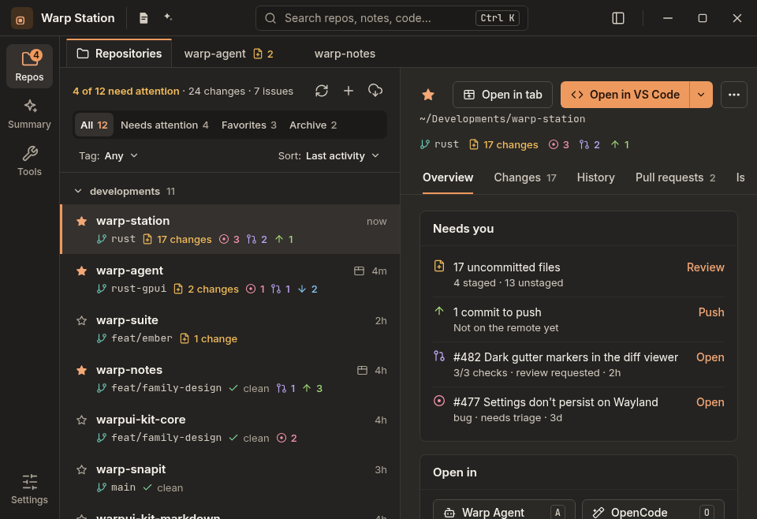
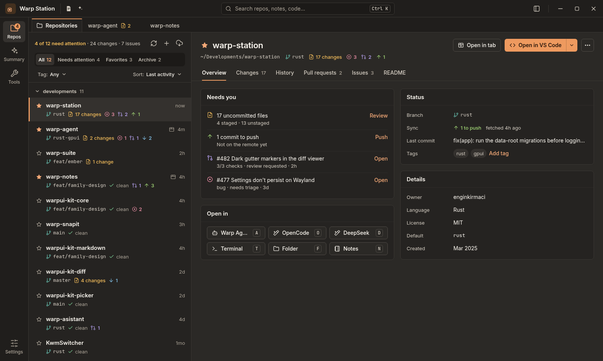
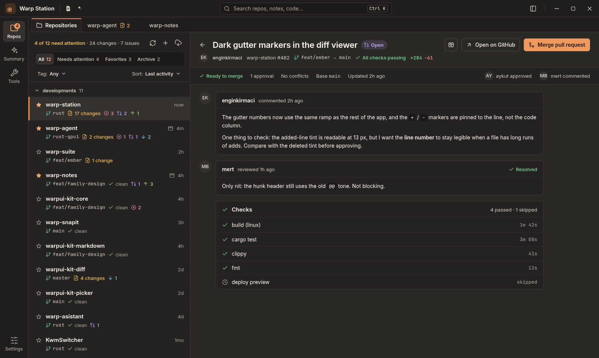

# Warp Station — UI design review

**Date:** 5 November 2026  
**Reviewed:** the v3 design contract, the GPUI implementation, and the committed working prototype  
**Checkout:** `warp-suite` at `128a2f8` (working tree already dirty from other work)

## Verdict

This is a **strong, coherent v3**. The redesign did what the brief asked: one shell
everywhere, one detail surface, a lifted dark palette, and type that is readable at a
glance. The visual system is the best part of the app, and the wait-state design is
better than most desktop developer tools.

At 1500 × 960 the hierarchy works: the eye goes selected repo → Needs you → the Review
link, with the rail and the list staying quiet. It reads as a professional workbench, not
a dashboard.

What holds it back is not taste. It is **resilience at the edges**: the shell is designed
for roughly 1500 × 960 and falls apart at the 960 px minimum; the interface is designed
for a mouse and mostly cannot be operated by keyboard; and several states that the
contract describes as first-class (archive, search, secrets, generated commits) are
treated as exceptions. Those are the next design pass, not a repaint.

### At a glance

| Area | Read |
|---|---|
| Visual language | **Strong** — warm Copper, quiet surfaces, one accent, confident density |
| Shell and information architecture | **Strong but heavy** — rail + list + detail, then a second tab strip inside detail |
| Type and colour | **Strong** — 12 px floor, real ladder, measured contrast; archived rows are the exception |
| Interaction clarity | **Mixed** — excellent busy states; too many hover-only, icon-only actions |
| Keyboard and accessibility | **Weak** — there is no focus model for the main surfaces |
| Responsive behaviour | **Weak** — header and detail tabs break below ~1200 px; PR detail is not covered |
| Contract adherence | **Mixed** — Settings, dialog metrics, and the sort menu have drifted |

## What works — keep this

- **The one-shell rule is actually implemented.** Summary, Tools, Settings and every repo
  open in rail + list + detail. There is no inspector, no bottom sheet, no second detail
  column. This is the redesign's biggest win and it reads immediately.
- **The type floor and palette are real systems.** Inter + JetBrains Mono, 12/13/14/15/16/22,
  four measured ramps, one accent per view. Nothing in the app invents a colour or a font.
  The contrast work is documented and tested.
- **Wait states are designed end to end.** A button turns into a spinner plus a verb, the
  row shows the job, the repo tab shows a spinner, the detail head shows a progress line,
  the title bar carries an activity chip, and the finish is a green check plus a toast.
  The busy language survives reduced motion. This is unusually complete.
- **Destructive actions are progressive.** Discard, remove, delete branch, merge and
  reset use a second-click confirm rather than a modal. That is the right pattern for a
  workbench and it is applied consistently.
- **The list and Overview answer the right question.** "What needs a person?" is visible
  in the summary line, the Needs attention filter and the Overview's first card. The
  repository row puts identity first and context second.

## Priority findings

### P0 — The supported minimum width breaks the shell

At 960 px (the app's own minimum), the product layout does not hold:

- **In preview mode the repository name disappears.** The detail head is one
  non-wrapping row: star, title, Open in tab, Open in VS Code + split, ⋯ menu. The fixed
  actions consume almost all of the ~400 px content width, so the title flexes to
  nothing. The repo name is gone exactly when the user is in the narrowest window with
  the list visible.
- **The detail tab strip is clipped.** Seven tabs (Overview, Changes, History, Pull
  requests, Issues, Pipelines, README) need roughly 640 px. At 960 the detail pane is
  about 400 px and the strip has no overflow or scroll affordance, so the last tabs are
  simply unreachable. Even at the contract's 1180 px compact threshold the seven tabs are
  borderline. The repository tab strip does scroll; the detail strip does not.
- **Pull request detail does not enter compact mode.** The automatic list-hide rule
  covers only Changes and History. A pull request opened from the preview keeps the repo
  list visible, leaving a 404 px detail pane for a title, back button, state pill, tab
  button, Open on GitHub and Merge. The same applies to the other wide repository views.

**Recommendation.** Add a compact detail head: title keeps priority, secondary actions
collapse to icons or an overflow menu, and `Open in tab` can drop to an icon when space
is tight. Make the detail tab strip scroll with edge fades or arrows. Extend the automatic
list-hide rule to PR detail and the other wide views. Put a 960/1180/1500 matrix in the
design contract so this cannot regress.

Evidence: `apps/warp-station/crates/warp-station/src/main.rs:114-119`,
`crates/warp-station/src/ui/detail.rs` (strip), `ui/overview.rs` (header),
`ui/repos.rs` (`list_visible` covers only Changes/History).

### P0 — The app assumes a mouse

The shell is visually polished, but the interaction model is not:

- **No focus model for the main surfaces.** Outside text inputs and pickers, the window
  root is the only focus handle. Rows, rail items, detail tabs, filters, card actions,
  list actions and dialogs are clickable divs; there is no tab order, no focus ring, no
  `tab_stop`, and no keyboard activation path for them. The global shortcuts (Ctrl+K, Ctrl+Tab, Ctrl+\\, S, C, A/O/D/T/F/N)
  are useful, but they are not a substitute for focus traversal.
- **Search cannot be driven from the keyboard.** Ctrl+K focuses the field, but results
  have no arrow/Enter handling and no active result. The user types, then has to reach
  for the mouse.
- **Arrow selection can walk off-screen.** `step_selection` changes the selected repo,
  but the list has no scroll handle and never scrolls the selection into view. After a
  few presses the detail changes while the highlighted row is below the fold.
- **Hover-only verbs are not reachable.** The row's "open in tab" and "open in app"
  actions are invisible until hover; tab close is invisible until hover on inactive
  tabs; the group filter icon is invisible until hover. A keyboard user cannot discover
  or reach them.

**Recommendation.** Treat this as a first-class design deliverable, not a code chore:
one visible focus ring token, a sensible tab order per screen, focus-visible actions on
rows and tabs, Enter/Space activation, arrow/Home/End in the repo list with
scroll-to-selection, and a combobox pattern for search. Add a keyboard checklist to the
design-system review.

Evidence: `ui/window.rs` (root focus, keymap), `store/mod.rs:2125-2151`
(`step_selection`), `ui/repos_list.rs` (row verbs), `ui/repos.rs` (strip close/group
filter), `ui/window.rs` (search popup has no result key handling).

### P0 — Search is an overlay that traps itself

The search field is prominent and the results are well grouped, but the popup is not a
well-behaved dropdown:

- It is shown whenever the query is non-empty. Clicking elsewhere does **not** close it;
  only Escape, clearing the text, or activating a result does. It can sit over the list
  and detail head while the user works underneath it.
- The result set is capped at 12 rows across all groups, with no "N more" and no total.
  Code hits can silently disappear once the repo/note groups fill the budget.
- There is no active-row state, no arrow navigation, and no Enter. It looks like a command
  palette but behaves like a static results panel.

**Recommendation.** Make it a proper combobox: focus/Escape/blur close, outside click
dismisses, Up/Down moves an active row, Enter activates, and the footer says `12 of 38`
or `Show all`. Keep the grouping; keep the "Searching…" state.

Evidence: `ui/window.rs` `render_search_popup` (no close-on-outside, `POPUP_ROWS = 12`,
no keyboard selection).

### P1 — Diffs are clipped, not scrollable

The Changes diff and the History/PR diff panes scroll vertically only. The diff renderer
puts every line in a full-width row with `overflow_hidden`; long lines simply run off the
right edge. At 1500 px the diff already cuts code; at 960 px it is much worse. A code
review surface that cannot show the end of a line is not usable for real code.

Add horizontal scrolling with a sticky line-number gutter, or a wrap toggle, and test a
file with a 200-character line. The same fix belongs in the PR and History diff surfaces.

Evidence: `ui/changes.rs` (`changes-diff-scroll` is `overflow_y_scroll` only),
`kits/warpui-kit-diff/src/lib.rs` (`full_row` uses `overflow_hidden`).

### P1 — Archive is both semantically ambiguous and visually unreadable

Two problems meet in the same state:

- **The filter model is mixed.** `All`, `Needs attention`, `Favorites` and `Archive` sit in
  one segmented row, which reads as single-select. But `Archive` is a visibility toggle:
  `All` and `Archive` can be active at the same time, `All`'s count excludes archived
  repos, and clicking `All` also switches archived rows off. On this machine
  `ShowArchived` is true, so the list can show more rows than the `All 12` count claims.
- **Archived rows are too faint to read.** The whole row gets `opacity(0.55)` **and** the
  name uses `text_muted`. Against the base surface that is about **2.9:1**; the metadata
  is around 3.8:1. The palette test does not cover this state. Users browsing the archive
  still need to read the names, branch and counts.

**Recommendation.** Either make Archive a true peer scope (only archived rows, with a
consistent count) or move "Show archived" to a separate switch/menu outside the scope
segments. Replace whole-row opacity with a muted-but-passing surface treatment and a
small "Archived" badge; verify it in the palette contrast test.

Evidence: `ui/repos.rs` (scope segment active states), `ui/repos_list.rs` (`opacity(0.55)`
and `name_color` for archived rows), `~/.warp/settings.json` (`ShowArchived: true`).

### P1 — The Azure DevOps PAT is shown in clear text

The Settings → Integrations page uses the ordinary `field::custom` for
`Azure DevOps PAT`. A PAT is a credential; it is rendered as normal mono text, with no
mask, no reveal control and no stored-state treatment. The app already has a Clipboard
Password tool that never shows its secret, so this is an inconsistency as much as a
security concern.

**Recommendation.** Use the field's password mask with an explicit reveal toggle and a
"stored" state when the field is populated. Do not echo the token on open. Add the same
treatment to any future credential field.

Evidence: `ui/settings.rs` (PAT row, `field_row` uses `field::custom`), `kits/warpui-kit-core/src/field.rs`
(supports a mask).

### P1 — "Generate & Commit" writes history before the user can read the message

When the commit box is empty, the filled primary is **Generate & Commit**. Pressing it
sets `auto_commit_after_draft`, drafts a message with warp-agent, and then commits
automatically when the draft arrives. The user never gets an editable review step, and
the safe path — the small wand in the corner that only drafts — is much less prominent.

A commit is durable project history. Generating a message is a suggestion; committing it
without review is a different act. The current label is honest, but the default is still
too eager for a workbench.

**Recommendation.** Generate into the message box and leave the primary as **Commit**.
If a one-click flow is kept, make it a distinct, explicit "Generate & Commit" action
behind a second-click confirm or a clear "Draft only" default. Keep the wand for
generate-only.

Evidence: `ui/changes.rs` (`auto_commit_after_draft`, `generate_and_commit`, the corner
wand and the primary).

### P1 — Icon-only controls depend on an optional tooltip

Many actions are icon-only: the sibling app links in the title bar, Refresh/Add/Clone in
the list head, row verbs, tab close, window controls. The only explanation is a tooltip
(and, for screen readers, an `aria_label`). The app then offers **Show tooltips** as a
setting; turning it off leaves sighted users with unexplained glyphs. The warp-agent link
is a sparkle that reads as a plus, and the Summary rail item uses the same sparkle family
as the AI actions.

**Recommendation.** Persistent labels for any action a new user cannot identify from the
glyph alone — at minimum a labelled Suite menu for the sibling apps, labelled Add/Clone
actions or one `+` split menu, and a distinct Summary icon. Tooltips should explain, not
carry the meaning. Do not let a display preference remove the only visible label.

Evidence: `ui/window.rs` (app links, title bar), `ui/repos.rs` (`icon_action`), `ui/window.rs`
(Summary rail uses `icon-agent-sparkle.svg`), `ui/mod.rs` (`with_tooltip`).

## Second pass — hierarchy and language

### The primary action leaves the app

On Overview, the one filled button is **Open in VS Code**. The page's actual work — 17
uncommitted files — is represented by a text link called **Review** inside the Needs you
card. This follows the contract ("the open tab owns the primary"), but it optimizes the
hierarchy for exiting the app rather than for the workbench's job. A developer opening a
dirty repo usually wants to review or commit before launching an editor.

**Recommendation.** When the repo needs attention, make **Review changes** the filled
primary and demote **Open in VS Code** to the split secondary. On a clean repo, the
current choice is fine. One filled primary per view still holds.

### The "Open in" card repeats the header menu

The header's split menu already lists every launcher. The Overview card repeats the same
launchers as a six-button grid, which is the largest block on the page after Needs you.
It makes the page feel like an app drawer and pushes the useful status further down.

**Recommendation.** Keep two or three most-used launchers in the card, or remove the card
and let the split menu carry the full list. If the card stays, separate **Editors** from
**AI / CLI** actions; "Open in OpenCode" is not the same verb as "Open in VS Code".

### The row is a rainbow, not a quiet list

The row can show branch (teal), changes (yellow), issues (pink), pull requests (violet),
behind (blue), ahead (green) and clean (green check). Every count is tinted. The design
principle says a healthy row stays quiet; in practice a healthy repo with one PR and one
unpushed commit already shows four colours. The owner asked for icons, not for a
dashboard.

**Recommendation.** Keep branch, changes, issues and PRs; render branch in the mono
secondary ink with only its icon tinted, and collapse ahead/behind into one quiet sync
cluster. Let the row use strong colour only when something needs a person. That makes
the Needs attention filter visually obvious.

### Small is a little too small

Small multiplies the ladder by 0.875, which puts body copy at 12.25 px and row names at
13.1 px. The 12 px floor holds — technically — but a 12.25 px body is roughly a
quarter less area than Normal and is at the edge of the legibility principle this redesign was
built on. This machine's shared `~/.warp/ui.json` currently says `small`, so the live app
is denser than the Normal screenshots here.

**Recommendation.** Keep Normal as the shipping default, and consider 0.92 for Small.
Do not let the smallest option land under 13 px for body copy.

### Two tab strips, two active-state languages

The top strip switches repositories (surface fill + 2 px accent line on top); the detail
strip switches sections (bottom accent underline). Both look like tabs. At 1500 px the
hierarchy is learnable; at 960 px the bottom strip is clipped anyway. The second strip
also creates a visual "tab bar inside a tab bar" that is unusual on desktop.

**Recommendation.** Either make the repository strip read as document tabs (document
icon, stronger surface, close affordance) and the detail strip as section navigation
(text-only, underline), or move repository tabs into the title bar. Add the rule to the
contract.

### Language: "Needs you", "Needs attention", "need attention"

The same state is named three ways: the card says **Needs you**, the filter says **Needs
attention**, the summary says **need attention**, and the sort says **Attention first**.
"Open" links inside Need you do not say where they open. "Open in" mixes editors, a
terminal, a folder, notes and AI CLIs.

**Recommendation.** Pick one phrase for the state (I would use **Needs attention**
everywhere) and make verbs specific: **Review changes**, **Push 1 commit**, **Open PR on
GitHub**, **Open issue on GitHub**. Rename the launcher card **Launch** or split it into
**Editors** and **AI**. This is small copy work with a large clarity gain.

### First run is a dead end

The list empty state says "No scan folders yet — add a repository to start" but offers no
button. The only Add/Clone controls are two 30 px icons in the list head, and the Overview
empty state is just "No repositories yet". This violates the contract's own empty-state
rule ("say what is true and offer the next step").

**Recommendation.** Put a primary **Add repositories** / **Scan a folder** CTA in the empty
state, with **Clone from URL** as the secondary. Make "No repositories found under the
scan folders" offer **Open Settings**.

### Settings autosave has drifted from the contract

The app autosaves every Settings text edit after a 600 ms debounce (toggles and pickers
commit at once) and shows a transient "saved ✓"; `DESIGN.md` still says edits wait for
**Save**. Autosave is a defensible choice
— fewer steps, no lost dirty state — but it needs the trust furniture the contract
implied: a persistent save/error state, an undo affordance, and validation. Today an
invalid max scan depth silently becomes `3`, and closing the app within the debounce
window can lose the last keystroke.

**Recommendation.** Decide which model is canonical and update both sides. If autosave
stays, add per-section validation and a short undo for scan folders/executable paths; if
Save returns, restore the footer and the dirty state.

## Contract drift (small, but worth reconciling)

| Contract | Implementation |
|---|---|
| Dialog radius 10 | Dialog cards use 8 (`ui/dialogs.rs`) |
| Control height 34 | Dialogs use 26 px buttons; list tools 26–30 px; tab close 22 px |
| Section headings 16 | Overview card heads use 15 (`overview.rs` `section_title`) |
| Settings wait for Save | Autosave after 600 ms (no Save) |
| Sort: Last activity, Name, Attention first | Six modes including Changes, GitHub, Branch |
| Empty states offer next step | List and Overview empty states are text-only |
| Dialog width/feel | Dialog cards are 520 px, not the prototype's 440 px |

None of these are individually fatal; together they make the system feel slightly less
owned than the palette and type work.

## Recommended sequence

1. **Make 960 px honest (1–2 days).** Compact detail head, scrollable/clipped tab strip,
   PR detail in compact mode, a 960/1180/1500 probe matrix. This is the highest visible
   return.
2. **Give the app a keyboard (2–3 days).** Focus tokens and tab order, row focus-visible
   actions, scroll-to-selection, search as a combobox with active results. Test with a
   keyboard only, not a mouse.
3. **Close the trust gaps (1 day).** Mask the PAT; make Generate & Commit a review step;
   add the first-run CTA; clarify Archive.
4. **Fix the review surface (1 day).** Horizontal diff scrolling or wrap, same in History
   and PR.
5. **Do the visual cleanup (1–2 days).** Primary action hierarchy, Open in duplication,
   row colour discipline, wording, dialog metrics.
6. **Reconcile the contract and add regressions.** Update `DESIGN.md` for autosave and
   the compact shell; add screenshot/bounds probes at 960, 1180 and 1500.

## Evidence and method

- **Visual references:** the committed v3 prototype (`design/v3/app.html`) at 1500×958 and
  960×658, because the live binary could not be captured in this session. The prototype
  and the GPUI implementation share the same shell constants and page structure, so the
  layout failures reproduce in the source; the exact pixel counts are approximations.
  The screenshots are Normal text size; this machine's `~/.warp/ui.json` is set to
  `small`, so the live app is slightly denser still.
- **Source references:** paths above are relative to `apps/warp-station/crates/warp-station/`
  unless noted; design claims are relative to `design/v3/DESIGN.md`.
- **Live capture note:** I launched the installed binary and attempted a window capture.
  Hyprland aborted in its screencopy path and restarted in safe mode; I stopped desktop
  interaction. The findings do not depend on that capture.
- **No app code was changed by this review.**

### Screens reviewed

Overview, Changes, History, Pull requests, PR detail, Issues, README, Summary,
Tools/Formatters, Settings/Appearance/General, the repository list at 960 and 1500,
and the Add/Clone dialogs from source.

